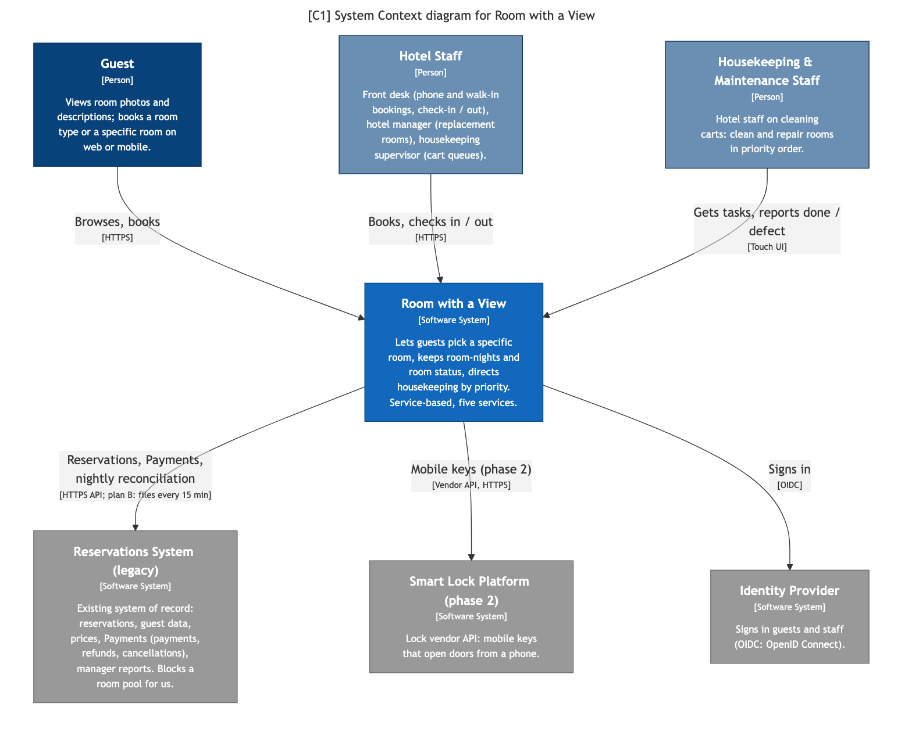
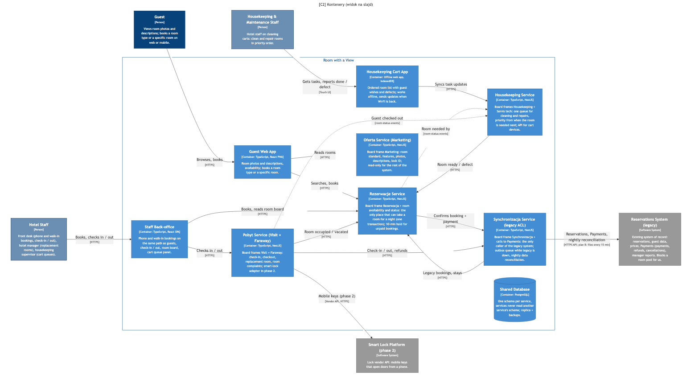

# Prezentacja: Room with a View (zespół White)

Ok. 4 minuty. Wszystko poniżej bierzemy z `notatki.md`. Diagramy generujemy z `c4/workspace.dsl` (`./zadanie/c4/render.sh`).

## Jednym zdaniem

Proponujemy **service-based: pięć serwisów domenowych i jedna baza**, bo system musi być na tyle prosty, żeby działał w czerwcu, musi dogadać się z legacy i urządzeniami i nie może zatrzymać hotelu, kiedy coś padnie.

## 1. Problem i liczby (ok. 40 s)

- 107 hoteli po ok. 200 pokoi, czyli ok. 21 tys. pokoi; 42 hotele w USA robią 2500 rezerwacji dziennie
- dziś rezerwacje idą głównie przez telefon i przy wejściu, a gość chce sam wybrać konkretny pokój, np. daleko od windy
- sezon startuje na początku czerwca, obłożenie dochodzi do ok. 90%
- dla biznesu najważniejsze jest sprzątanie: pokój ma być gotowy w 15 minut (od „gotowy do sprzątania” do „gotowy dla gościa”)
- policzyliśmy ruch: ok. 6400 rezerwacji dziennie, średnio jedna co 14 sekund; wymeldowania między 10 a 12 to ok. jedno na 2 minuty w hotelu
- wniosek: ruch jest mały, nasz problem to termin, legacy i awarie, a nie skalowanie

## 2. Top 3 charakterystyki (ok. 40 s)

1. **Prostota**: architektura ma być prosta, nie tylko obsługa; działa w czerwcu albo czekamy rok, więc mało serwisów, jedna baza, bez egzotycznej technologii
2. **Integracje**: prawie wszystko idzie przez cudze systemy: legacy, smart locki, urządzenia przy wózkach, cztery kanały; zmiana API legacy rusza tylko Synchronizację
3. **Odporność na awarie**: przy 90% obłożenia hotel nie może stanąć; legacy nie odpowiada pół godziny, a check-in, checkout i sprzątanie działają dalej

- świadomie odrzuciliśmy skalowalność: „peak season” w zadaniu to termin, nie ruch
- spójność danych jest ważna, ale pilnuje jej pula pokoi i jedno miejsce zapisu pokoju na noc, a nie wybór stylu

## 3. C1: kontekst (ok. 20 s)

- trzy grupy ludzi: gość, personel hotelu (recepcja, manager, kierowniczka sprzątania), housekeeping i serwis techniczny
- legacy zostaje systemem rezerwacji, cen, raportów i płatności (Payments); odgórnie blokuje dla nas pulę pokoi
- smart locki dopiero w etapie 2

## 4. C2: kontenery (ok. 50 s)

Pięć serwisów, każdy to jedna lub dwie ramki z naszej tablicy:

- **Rezerwacje**: ramka Rezerwacja razem z dostępnością i statusem pokoju; jedyne miejsce, które może zająć pokój na noc, bo to musi być jedna transakcja
- **Housekeeping**: ramki Housekeeping i Servis tech razem, bo to ci sami ludzie, jedna kolejka i ten sam priorytet; do tego API dla urządzeń przy wózkach
- **Pobyt**: ramki Visit i Faraway, czyli początek i koniec tego samego pobytu; w etapie 2 klucze mobilne
- **Synchronizacja**: jedyny serwis, który rozmawia z legacy, także o płatnościach; kolejka na czas awarii legacy i porównanie danych raz dziennie
- **Oferta**: ramka Marketing, zdjęcia i opisy, tylko do odczytu dla reszty
- wszystkie kanały (web, mobile, telefon, walk-in) idą przez jedno API Rezerwacji; recepcjonista rezerwuje tą samą ścieżką co gość
- aplikacja na wózki to aplikacja webowa działająca offline, bo Wi-Fi w hotelu się rwie

## 5. Kluczowe decyzje i ich cena (ok. 60 s)

**Styl: service-based**

- w arkuszu stylów dla naszego top 3 event-driven ma 10 gwiazdek, service-based 9; mówimy to wprost
- mimo to service-based: event-driven daje spójność ostateczną tam, gdzie blokada pokoju potrzebuje transakcji, i ma za dużo ruchomych części jak na czerwiec
- modularny monolit i microkernel są tańsze i prostsze, ale jak padnie aplikacja, pada wszystko
- cena: pięć rzeczy do wdrożenia zamiast jednej i wywołania po sieci między serwisami

**Jedna baza PostgreSQL, osobny schemat na serwis**

- prostsze niż baza na serwis, a blokadę pokoju na noc załatwia jedna transakcja w Rezerwacjach
- serwisy nie czytają cudzych schematów
- cena: baza to wspólny punkt awarii, więc replika i backupy

**Legacy przez API od razu, schowane za Synchronizacją**

- rezerwacje i płatności idą do legacy od razu, bo synchronizacja raz dziennie nie potwierdziłaby płatności; raz dziennie robimy tylko porównanie danych
- płatności i dane kart zostają w legacy
- jak API legacy nie zdąży na czerwiec, plan B to wymiana plików co 15 minut, reszta systemu bez zmian
- cena: pokój na noc i status trzymamy u siebie, więc codziennie porównujemy dane z legacy

## 6. Ryzyka i otwarte sprawy (ok. 30 s)

- kiedy będzie gotowe API legacy i czy zdążymy przed czerwcem (plan B: pliki co 15 minut)
- czy blokowanie pokoi w legacy działa już dziś; na razie to zakładamy
- jak duża ma być pula na hotel i kto ją ustala
- gdzie są hotele spoza USA i czy dane gości muszą tam zostać; na start jeden region USA, ten sam zestaw serwisów można postawić w drugim
- co biznes miał na myśli przez „kupowanie rzeczy dla gości”: życzenia do pokoju czy osobny sklep

## Peer review: pytania i odpowiedzi

**Dlaczego nie event-driven, skoro ma więcej gwiazdek?**
- to jeden punkt różnicy; event-driven daje spójność ostateczną, a zajęcie pokoju na noc potrzebuje transakcji
- do tego więcej ruchomych części, a termin to czerwiec

**Dlaczego nie modularny monolit albo microkernel?**
- są tańsze i prostsze, ale jak padnie aplikacja, staje rezerwacja, check-in i sprzątanie naraz
- odporność na awarie mamy w top 3, więc płacimy pięcioma wdrożeniami zamiast jednego

**Dlaczego nie mikroserwisy?**
- za dużo ruchomych części na nasz termin, a przy jednej rezerwacji co 14 sekund nic z tego nie potrzebujemy

**Wspólna baza to punkt awarii?**
- tak, świadomie: replika i backupy; każdy serwis ma swój schemat i nie czyta cudzych

**Co jak legacy leży?**
- płatności czekają w kolejce w Synchronizacji; check-in, checkout i sprzątanie działają dalej
- jak padnie serwis Rezerwacje, housekeeping dalej działa

**Co jak padnie cały nasz system?**
- recepcja ma odświeżaną co kwadrans listę przyjazdów, wyjazdów i statusów, robi check-in ręcznie i dopisuje potem

**Jak unikacie podwójnej rezerwacji?**
- legacy odgórnie blokuje dla nas pulę i jej nie sprzedaje; o pokoju z puli na daną noc decyduje tylko Rezerwacje
- niezapłacona rezerwacja trzyma pokój 10 minut, potem pokój wraca do sprzedaży

**Co ze skalowaniem?**
- ruch jest mały; wracamy do tematu, jak przekroczymy ok. 100 rezerwacji na minutę

**Co jak wózek traci Wi-Fi?**
- aplikacja działa offline i wysyła zmiany, kiedy łączność wraca

**Housekeeping tylko dla pokoi z puli?**
- nie, dla wszystkich pokoi hotelu od pierwszego dnia; dla pokoi spoza puli bierzemy zameldowania i wymeldowania z legacy co kilka minut

**Wybrany pokój nie jest gotowy albo ma usterkę?**
- usterka blokująca zdejmuje pokój ze sprzedaży; manager wybiera gościom pokój zastępczy, także przy check-in

**Gdzie bezpieczeństwo?**
- dane kart zostają w legacy; klucze mobilne dopiero w etapie 2, jako adapter w Pobycie; housekeeper dostaje klucz tylko do swojego pokoju na czas sprzątania

**Co z obietnicami handlowców?**
- zapisujemy je jako życzenia w rezerwacji; system sprawdza, czy się da, a jak nie, daje znać managerowi
